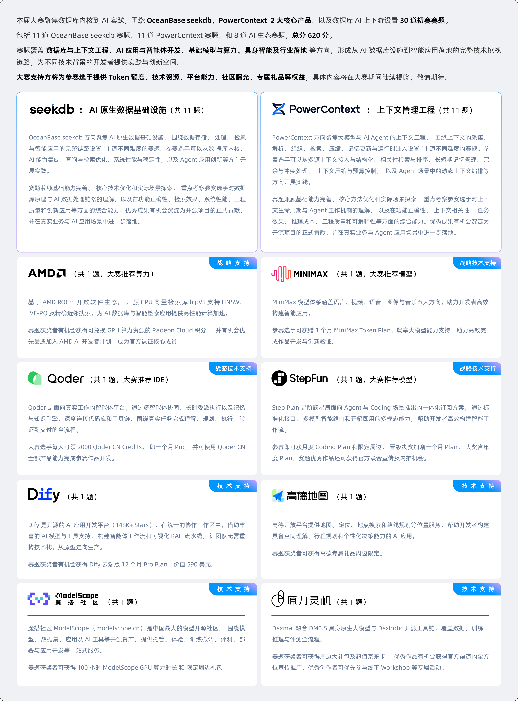

# 课程 Lab

本课程实验基于 OceanBase 开发的 seekdb 数据库系统和第六届 OceanBase 数据库大赛设计。后续实验参考本届大赛赛题，并采用与大赛一致的 OceanBase 官方评测机制评分。

## 实验文档

建议按以下顺序阅读：

1. [课程文档索引](README.md)
2. [Lab 0：seekdb 架构导读](lab-0-seekdb-architecture.md)
3. [seekdb 从源码构建与部署](seekdb-install-and-deploy.md)
4. [Lab 0 架构讲义（PDF）](lab-0-seekdb-architecture.pdf)

## 相关资料

- [seekdb GitHub 仓库](https://github.com/oceanbase/seekdb)
- [第六届 OceanBase 数据库大赛](https://open.oceanbase.com/competition)
- seekdb 环境搭建指南：安装工具链、获取代码并完成编译
- 2026 从 0 到 1 数据库实践教程：视频讲解
- 2026 数据库大赛官方手册
- OceanBase 训练营

> 后四项资料在原始课程文本中未附 URL。补充可靠地址后再将其改为链接。

## 实验安排

课程使用官方 seekdb 赛题中的前两个赛题：

| 实验 | 主题 | 评分项 | 总分 |
| --- | --- | ---: | ---: |
| Lab 1 | AI 函数增强 | 6 个子题 | 60 分 |
| Lab 2 | 文件即数据库 | 8 个评分项 | 50 分 |

以下要求摘录并整理自官方赛题说明。

## Lab 1：AI 函数增强

### 题目背景

seekdb 已支持 `AI_PROMPT`、`AI_COMPLETE`、`AI_EMBED`、`AI_RERANK` 以及 AI Model Endpoint 管理。本题要求在现有实现上补齐类型支持、Provider 协议、结果校验和批量执行能力。

比赛不考察模型效果，也不需要调用真实模型。所有模型请求由组委会提供的 Mock AI Service 响应。

### 通用要求

- 基于 seekdb SQL 引擎实现，不得在应用层绕过。
- 不得针对模型名、输入或响应硬编码。
- 不得破坏现有 AI 函数和普通 SQL。
- 异常输入或网络错误不得导致崩溃、结果错位或资源泄漏。

### 子题

| 子题 | 主要要求 |
| --- | --- |
| `AI_PROMPT` 类型与模板增强 | 支持 `TEXT`/`LONGTEXT`、JSON、嵌套 Prompt、重复和非法占位符、Unicode 与转义 |
| `AI_EMBED` 单行语义 | 支持单行和多行；校验正整数 `dimension`、向量维度及元素合法性 |
| `AI_COMPLETE` 请求与响应 | 支持普通 Prompt、`AI_PROMPT`、JSON config、长文本及异常响应 |
| Ollama Provider | 支持 Endpoint 增删改查、免 API Key、大小写兼容、非流式生成和 Embedding |
| `AI_RERANK` 结果正确性 | 支持字符串或对象数组、分批、全局 index 映射、稳定排序和返回校验 |
| `AI_EMBED` 跨行批量 | 单个请求携带多条输入；正确处理乱序响应、`NULL`、过滤、`LIMIT`、多批次和失败 |

### 评分标准

| 子题 | 评分重点 | 分值 |
| --- | --- | ---: |
| `AI_PROMPT` 类型与模板增强 | JSON Array/Object 参数 4；重复占位符替换 3；`LONGTEXT`/`TEXT` 模板与参数 3 | 10 |
| `AI_EMBED` 单行语义 | 默认维度 4；显式 `dimension` 参数 3；返回 JSON 及向量维度校验 3 | 10 |
| `AI_COMPLETE` 请求与响应 | OpenAI 模型及 Endpoint 配置 3；基础调用与 `NULL` 配置 3；`temperature`/`max_tokens` 配置 2；响应非空校验 2 | 10 |
| Ollama Provider | Endpoint 创建及 Provider 修改 3；空 access key 兼容 2；原生 Completion 协议 3；原生 Embedding 协议 2 | 10 |
| `AI_RERANK` 结果正确性 | 字符串数组输入 3；对象数组及文本字段选择 3；返回数量、顺序与原始 ID 映射 4 | 10 |
| `AI_EMBED` 跨行批量 | 表扫描中的多行调用 3；`NULL` 输入传播 3；结果与原始行的顺序、维度映射 4 | 10 |
| **合计** |  | **60** |

### 测试代码

| 类型 | 文件 | 主要内容 |
| --- | --- | --- |
| Unit test | `unittest/sql/engine/expr/ob_expr_ai_prompt_test.cpp` | JSON、重复占位符、嵌套 Prompt、非法下标 |
| Unit test | `unittest/sql/engine/expr/test_ob_openai_utils.cpp` | Embedding 校验与乱序恢复、Ollama 请求和响应 |
| mysqltest | `tools/deploy/mysql_test/test_suite/ai_function/t/ai_function_enhancement.test` | 六类功能的端到端主流程 |
| mysqltest | `tools/deploy/mysql_test/test_suite/ai_function/t/ai_prompt.test` | `AI_PROMPT` 类型和参数测试 |

`ai_function_enhancement.test` 依赖运行在 `0.0.0.0:8000` 的 Mock AI Service。

## Lab 2：文件即数据库

### 题目背景

AI Agent 经常需要分析本地 CSV、JSONL 和 Parquet 文件。传统流程需要先建表、导入数据，再执行 SQL，增加了准备工作和数据副本。

本题要求在 seekdb 中实现“文件即数据库”：通过 `read_csv`、`read_json`/`read_ndjson`、`read_parquet` 直接读取文件，自动生成列结构，并由 seekdb SQL 引擎完成过滤、聚合、排序和 JOIN。用户无需预先建表或导入数据。

### 通用要求

- 基于 seekdb SQL 引擎实现，不得使用 DuckDB、SQLite、Polars SQL 等外部查询引擎代执行。
- 不得针对文件名、数据内容或查询结果硬编码。
- 面向单进程本地文件场景，输入文件只读；功能默认关闭，开启 `enable_file_sql` 后仍须通过 `secure_file_priv` 校验。
- 不得破坏现有普通 SQL；异常数据、路径越界和文件变化不得导致崩溃、错误结果或资源泄漏。
- 文件扫描应流式执行，支持批量取数和重扫，不得将全文件数据物化到内存。

### 子题

| 子题 | 主要要求 |
| --- | --- |
| SQL 接口与文件发现 | 支持 `read_csv`、`read_json`、`read_parquet`、`glob`、`DESCRIBE SELECT * FROM read_*()`；命名参数、别名和动态列元数据正确 |
| CSV 读取 | 支持表头、UTF-8、LF/CRLF、引号与转义、字段内换行、`NULL`、坏行诊断和批量扫描 |
| JSONL 读取 | 支持扁平对象、字段并集、缺失字段补 `NULL`、类型冲突处理；拒绝嵌套对象和数组 |
| Parquet 读取 | 支持 Footer Schema、多 Row Group、可空列、基础类型及列裁剪 |
| 确定性类型推断 | 支持 `BIGINT`、`DOUBLE`、`BOOLEAN`、`VARCHAR`、`DATE`、`DATETIME`、`NULL`；处理类型宽化、边界值和全 `NULL` 列 |
| 单文件 SQL | 支持表达式、别名、`WHERE`、`ORDER BY`、`LIMIT`、`GROUP BY`、`HAVING` 及 `COUNT`/`SUM`/`AVG`/`MIN`/`MAX` |
| 双文件 JOIN | 支持 `INNER JOIN`、`LEFT JOIN` 和跨格式 JOIN，使用 seekdb 原生执行计划 |
| 安全、稳定性与工程质量 | 功能开关、路径限制、文件变化检测、资源上限、错误诊断和单元测试 |

CSV 和 JSONL 使用全量 Schema 推断，`sample_size` 仅支持 `-1`。本题不要求远程文件、多文件自动合并、嵌套结构或分布式扫描。`glob()` 仅用于发现文件，返回一列 `file`。

同时支持 `COPY table-or-query TO path` 导出 CSV，包括表头、分隔符、引号、转义和 `NULL` 文本选项。输出应可由 `read_csv` 读回；目标已存在时失败，查询失败时清理临时文件。COPY 不单列分值。

> **待确认：**官方摘录前文标注本题总分为 50 分，此处原文写有“评分总分沿用原设计的 30 分”。两处信息冲突，课程评分应以最新官方规则或教师通知为准。

### 评分标准

| 子题 | 评分重点 | 分值 |
| --- | --- | ---: |
| SQL 接口与文件发现 | 读取入口、`glob`、`DESCRIBE`；命名参数、别名和动态列元数据 | 7 |
| CSV 读取 | 表头与 UTF-8；引号、转义与换行；`NULL`、坏行诊断及批量扫描 | 10 |
| JSONL 读取 | 扁平对象；字段并集与缺失值；`NULL`、类型冲突及错误定位 | 7 |
| Parquet 读取 | Footer Schema；多 Row Group；可空列、基础类型和列裁剪 | 6 |
| 确定性类型推断 | 七类类型、宽化规则、数值边界、日期合法性及全 `NULL` 列 | 6 |
| 单文件 SQL | 投影与表达式、过滤、排序与 `LIMIT`、分组与聚合；计划走 seekdb | 6 |
| 双文件 JOIN | `INNER JOIN`、`LEFT JOIN`、至少一种跨格式 JOIN；计划走 seekdb | 4 |
| 安全、稳定性与工程质量 | 默认关闭、`secure_file_priv`、防路径逃逸、文件变化、资源限制及测试 | 4 |
| **合计** |  | **50** |

各项按公开与隐藏测试的通过比例计分。使用外部查询引擎代执行，整题记 0 分；突破只读边界或绕过 `secure_file_priv`，安全项记 0 分并作为严重缺陷处理。不单独进行性能排名；因全文件物化导致 OOM 的用例判定失败。

### 测试代码

| 类型 | 文件 | 主要内容 |
| --- | --- | --- |
| Unit test | `unittest/sql/parser/test_file_sql_parser.cpp` | 文件读取函数、别名、命名参数、`glob`、`DESCRIBE` 和 `COPY` 语法 |
| Unit test | `unittest/sql/engine/basic/test_file_scan_utils.cpp` | CSV 推断与读取选项、JSONL 字段并集、文件变化检测、Parquet 编码与 Snappy |
| mysqltest | `tools/deploy/mysql_test/test_suite/file_sql/t/file_sql_basic.test` | 功能开关、三种格式读取、聚合、Schema 查看、文件发现及 COPY 导出读回 |

测试数据位于 `tools/deploy/mysql_test/test_suite/file_sql/data/`，由配套 include 脚本部署和清理。运行文件查询前需开启 `enable_file_sql`，并将测试目录配置在 `secure_file_priv` 允许范围内。当前基础测试未覆盖全部评分用例，JOIN、安全和异常路径等需补充专项测试。
